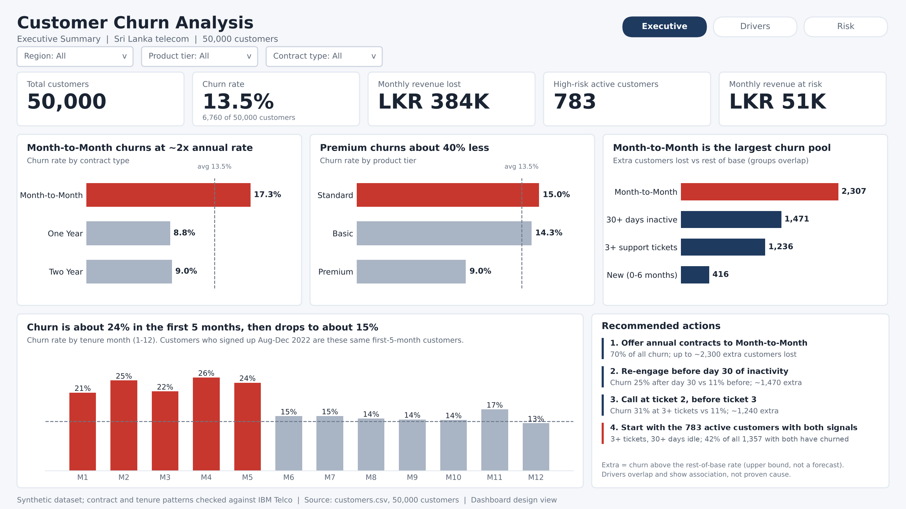
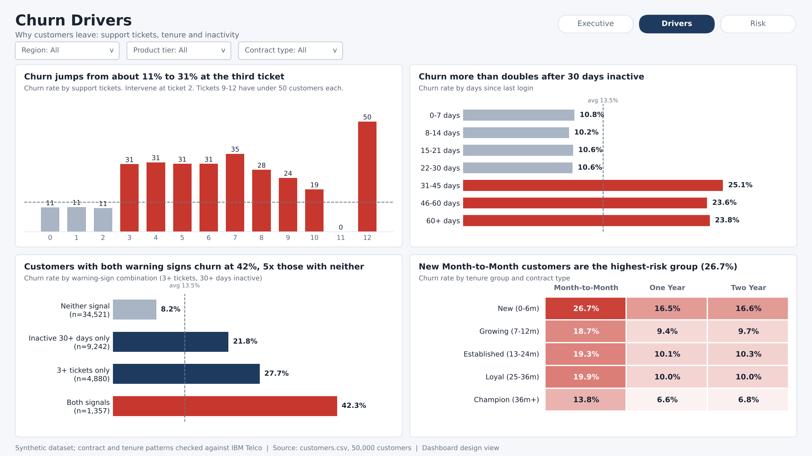
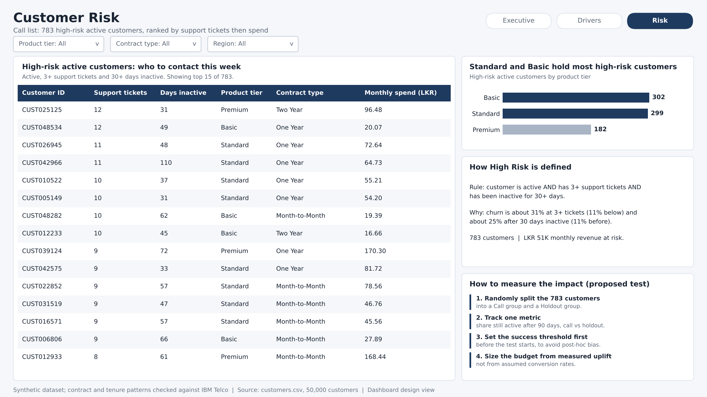
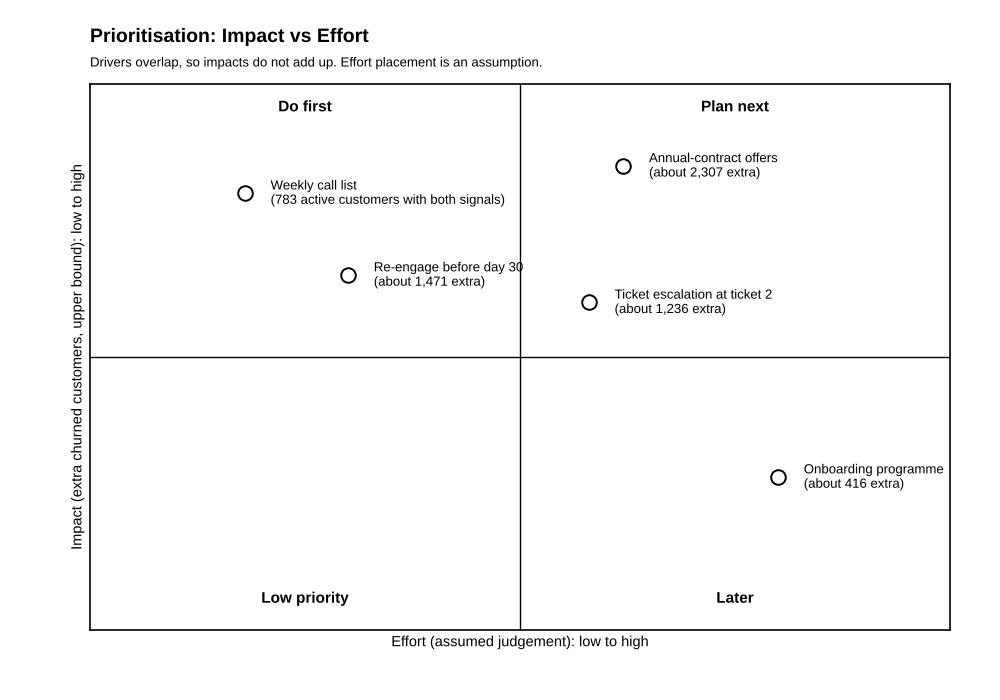
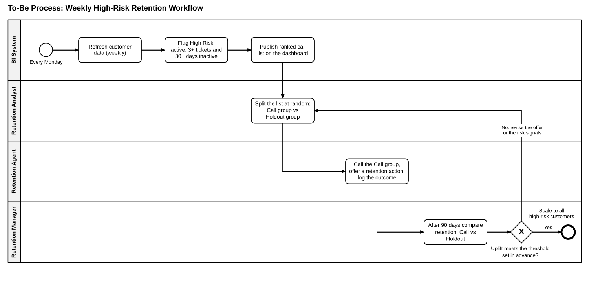
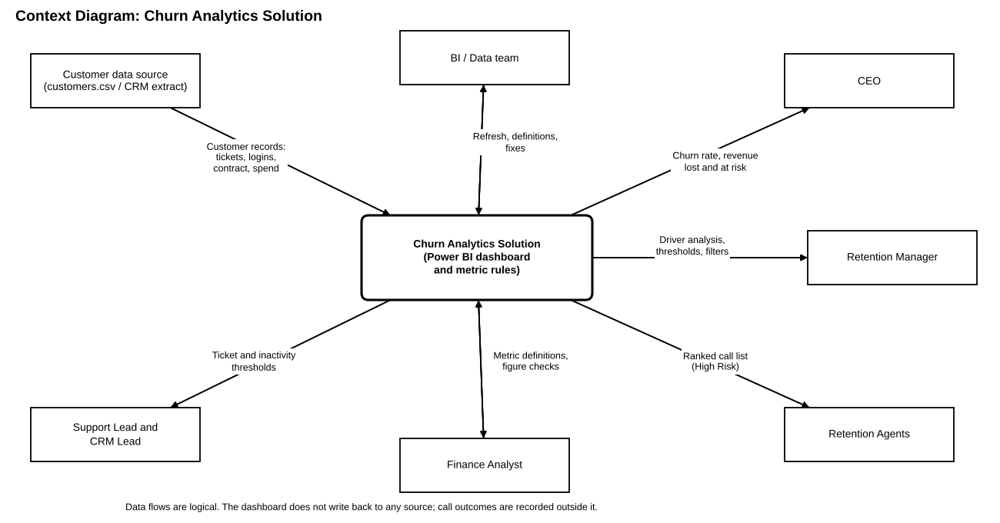

# Customer Churn Analysis: Sri Lanka Telecom (Simulated Data)

**Business Analysis | SQL | Power BI + DAX | Experiment design**

> **The question:** A retention team can only call a limited number of customers each week. Who should they call first, and how do they prove the calls work?
>
> **The answer in one line:** On a simulated 50,000-customer telecom base (13.5% churn, LKR 384K monthly revenue lost), one rule (3+ support tickets AND 30+ days inactive) produces a ranked call list of **783 active customers** (about LKR 51K monthly revenue at risk), tested with a proposed Call vs Holdout design.

> **Scope note:** The data is synthetic. The value of this project is the analytical workflow, metric definitions, requirements and decision support, not claims about the real Sri Lankan market. Stakeholders, the As-Is process and sign-offs are assumed.

**Walkthrough:** [`churn_case_study.pdf`](churn_case_study.pdf) | **Findings with evidence:** [`FINDINGS.md`](FINDINGS.md)

---

## At a glance

| | |
|---|---|
| **Role** | Business / BI Analyst (independent portfolio project) |
| **Data** | 50,000 synthetic customers: contract, tier, region, tenure, spend, support tickets, days since last login, churn flag |
| **Decision supported** | Which customers to contact first, and which retention levers to test |
| **Core output** | A High Risk rule, a 783-customer weekly call list, a proposed Call/Holdout test |
| **BA deliverables** | BRD, user stories with acceptance criteria, RACI, metric dictionary, BPMN As-Is/To-Be, context diagram, use cases, gap analysis, risk register, UAT cases, data model |
| **Status** | Analysis and documents complete. UAT cases are written, **not yet run**. The retention test is **proposed, not conducted** |

## Read this in 3 minutes

1. **This page**: problem, definitions, findings, limits.
2. [`docs/04_BRD.md`](docs/04_BRD.md): objectives, scope in/out, assumptions, success criteria.
3. [`docs/03_metric_dictionary.md`](docs/03_metric_dictionary.md): every KPI with its definition, DAX and caveat.
4. [`sql/05_high_risk_definition.sql`](sql/05_high_risk_definition.sql) and [`sql/10_weekly_call_list.sql`](sql/10_weekly_call_list.sql): the rule and the call list (783 rows, first row `CUST025125`).
5. [`diagrams/`](diagrams/): To-Be BPMN and context diagram.

---

## Preview

**Dashboard (design view)**







**Impact and effort matrix**



**Proposed weekly retention process (To-Be, BPMN)**



**Context diagram**



---

## 1. Business problem and decision

A telecom loses 13.5% of its customers (6,760 of 50,000). Retention effort is spent mostly on customers who have already left. The retention team has limited weekly capacity.

**Decision to support:** which active customers should be contacted first, and which retention levers are worth testing?

**Requirements view (assumed stakeholders, mapped in a RACI):**

| Objective | What it requires | Acceptance criterion |
|---|---|---|
| OBJ-3 | A weekly ranked call list of customers who are still active | 783 rows; first row `CUST025125` (12 tickets, 31 days, Premium, Two Year); UAT-09 |
| OBJ-4 | One shared definition of High Risk and every KPI | The rule is shown on the dashboard page; every KPI is defined in the metric dictionary |
| OBJ-5 | A way to prove the calls work | Random Call/Holdout test, 90-day retention, threshold set in advance |

Full set: 5 objectives, 9 user stories, 13 UAT cases in [`docs/`](docs/).

## 2. Data and metric definitions

- **Churn rate** = churned customers / total customers.
- **High Risk** = active customer with 3+ support tickets AND 30+ days inactive. Result: 783 customers, LKR 51,001 monthly spend.
- **Extra churn** (per driver) = churned customers in the group minus (group size x churn rate of the rest of the base). An **upper bound, not a forecast**. Drivers overlap, so the numbers do not add up.

## 3. Findings (verified against `customers.csv`)

| # | Finding | Evidence |
|---|---|---|
| 1 | Month-to-Month is the largest churn pool | 17.3% vs 8.8-9.0% on annual contracts; 70% of all churned customers; about 2,300 extra churned customers |
| 2 | Churn steps up after 30 days inactive | 10.6% up to day 30 vs 24.5% after; the step falls between day 30 (11%) and day 31 (26%) |
| 3 | Churn steps up at the third support ticket | 11.0% at 0-2 tickets vs 30.9% at 3+ (about 2.8x) |
| 4 | The two warning signs compound | 42.3% churn with both vs 8.2% with neither (about 5x) |
| 5 | First months are the riskiest | About 24% in months 1-5 vs about 15% in months 6-12; new Month-to-Month customers churn at 26.7% |
| 6 | Premium churns less | 9.0% vs 14.3% (Basic) and 15.0% (Standard) |

Region differs by under 1 point (13.1-14.0%), so it is not a priority lever.

**The two signals together (all 50,000 customers):**

| Group | Customers | Churn rate |
|---|---|---|
| Neither signal | 34,521 | 8.2% |
| Inactive 30+ days only | 9,242 | 21.8% |
| 3+ tickets only | 4,880 | 27.7% |
| **Both signals** | **1,357** | **42.3%** |

**From pattern to call list:** 1,357 customers show both signals. 574 of them (42.3%) have **already churned**. The other **783 are still active**: that is the call list. The 42.3% is a past rate across all 1,357. It is **not a forecast** for the 783.

## 4. Validation on real data (IBM Telco, 7,043 customers)

| Pattern | Simulated data | IBM Telco | Held? |
|---|---|---|---|
| Month-to-Month churns more | 17.3% vs 8.9% | 42.7% vs 6.8% | Yes (stronger) |
| New customers churn more | 22% (0-6m) vs 10.5% (36m+) | 52.9% vs 11.9% | Yes (stronger) |
| Support tickets, inactivity days | see above | No such columns in IBM Telco | **Cannot be validated** |

Only the contract and tenure patterns are checked on real data. The ticket and inactivity effects are specific to the simulated dataset.

## 5. Recommendations and prioritisation

Not implemented. Impact is the extra-churn upper bound from Section 2. **Effort is my assumption.**

| Priority | Action | Impact (extra churned customers, upper bound) | Effort (assumed) |
|---|---|---|---|
| 1. Do first | Call the 783 active customers with both warning signs | n/a (this is the pilot population) | Low |
| 2. Do first | Re-engage before day 30 of inactivity | about 1,471 | Low |
| 3. Plan next | Offer annual contracts to Month-to-Month customers | about 2,307 | Medium |
| 4. Plan next | Escalate at support ticket 2, before ticket 3 | about 1,236 | Medium |
| 5. Later | Onboarding programme for new customers (0-6 months) | about 416 | High |

## 6. How I would prove it works (proposed, not conducted)

1. Randomly split the 783 high-risk customers into a **Call group** and a **Holdout group** (keep the holdout a small, agreed share for ethical reasons).
2. **Primary metric:** share still active after 90 days, Call vs Holdout.
3. **Set the success threshold before the test.** If it is missed, revise the offer or the risk signals.
4. Size any budget from the **measured uplift**, not assumed conversion rates.
5. **Pilot only:** with 783 customers, even an even split can only detect gaps of roughly 10 percentage points.

## 7. What I got wrong and fixed

Part of the work was checking my own analysis:

- A High Risk rule that matched **zero** customers.
- A "4.2x" claim that was really **2.8x**.
- ROI figures I could not support, which I removed.
- A call list built on 1,357 customers, when only **783** were still active.

## 8. Limitations and what I would do with real data

- **Synthetic data:** churn was generated from rules, so the analysis recovers those rules. It demonstrates the method, not the market.
- **Association, not cause.** There is no prediction model; this is rule-based analysis.
- **Inactivity can partly be a result of leaving**, so read it as a warning sign.
- **Spend-drop hypothesis not testable:** no customer's spend falls more than 10% over 3 months in this data.
- **Single snapshot:** tenure and signup date move together, so a cohort effect cannot be separated from a tenure effect.
- **UAT cases are written, not yet run.** Stakeholders, the As-Is process, effort ratings and sign-offs are assumed.
- **With real CRM data:** use real churn labels, run the holdout test, add a model with cross-validation, and add cost per retention action to compute ROI.

## 9. Skills shown and where to see them

| Skill | Evidence |
|---|---|
| Requirements and traceability | `docs/01_requirements_and_user_stories.md`, `docs/04_BRD.md`, `docs/08_uat_test_cases.md` |
| Stakeholder analysis | `docs/02_stakeholders_and_raci.md` |
| Metric definition | `docs/03_metric_dictionary.md`, `powerbi/churn_measures.dax` |
| SQL analysis | `sql/` (11 queries, 05 and 10 define the rule and the call list) |
| Process modelling | `diagrams/` (BPMN As-Is and To-Be, context, use case) |
| Gap analysis, prioritisation, risk | `docs/06_gap_analysis_and_prioritisation.md`, `docs/07_risk_register.md` |
| Experiment design | Section 6 above |
| Self-audit and honest limits | Sections 7 and 8 above |

## 10. Repository guide

```text
telecom-customer-churn-analytics-2026/
├── README.md                       this case study
├── churn_case_study.pdf            case study PDF for sharing
├── FINDINGS.md                     findings with evidence
├── data/                           customers.csv (simulated), generate_dataset.py
├── sql/                            11 business queries (01-11)
├── notebooks/                      01_eda_generated.ipynb
├── powerbi/                        churn_dashboard.pbix, churn_measures.dax, churn_theme.json
├── screenshots/                    dashboard pages (design view)
├── diagrams/                       BPMN, context, use case (PNG and editable .drawio)
└── docs/                           BA documents
```

| Document | Purpose |
|---|---|
| `docs/00_methodology.md` | Data, definitions, validation, limitations |
| `docs/01_requirements_and_user_stories.md` | User stories, acceptance criteria, traceability |
| `docs/02_stakeholders_and_raci.md` | Stakeholder map and RACI (assumed) |
| `docs/03_metric_dictionary.md` | Every KPI: definition, DAX, value, caveat |
| `docs/04_BRD.md` | Business requirements document |
| `docs/05_use_cases.md` | Use cases and the UC-03 specification |
| `docs/06_gap_analysis_and_prioritisation.md` | As-Is vs To-Be, impact vs effort |
| `docs/07_risk_register.md` | 11 risks with mitigations |
| `docs/08_uat_test_cases.md` | 13 UAT cases with expected values (written, not yet run) |
| `docs/09_data_model_and_dictionary.md` | Data model and field dictionary |
| `docs/10_delivery_plan.md` | Indicative delivery plan (assumed) |

## 11. How to run

```bash
git clone https://github.com/kavigamage-da/telecom-customer-churn-analytics-2026
cd telecom-customer-churn-analytics-2026
pip install -r requirements.txt
python data/generate_dataset.py     # optional: regenerates the simulated data
```

Run the queries in `sql/` in order (01 to 11) against `data/customers.csv`. For Power BI, open `powerbi/churn_dashboard.pbix` and apply `powerbi/churn_theme.json`, or recreate the measures from `powerbi/churn_measures.dax`.

---

*Built by Kavindi Gamage. All stakeholders, processes and sign-offs in the documents are assumed for a simulated project.*
